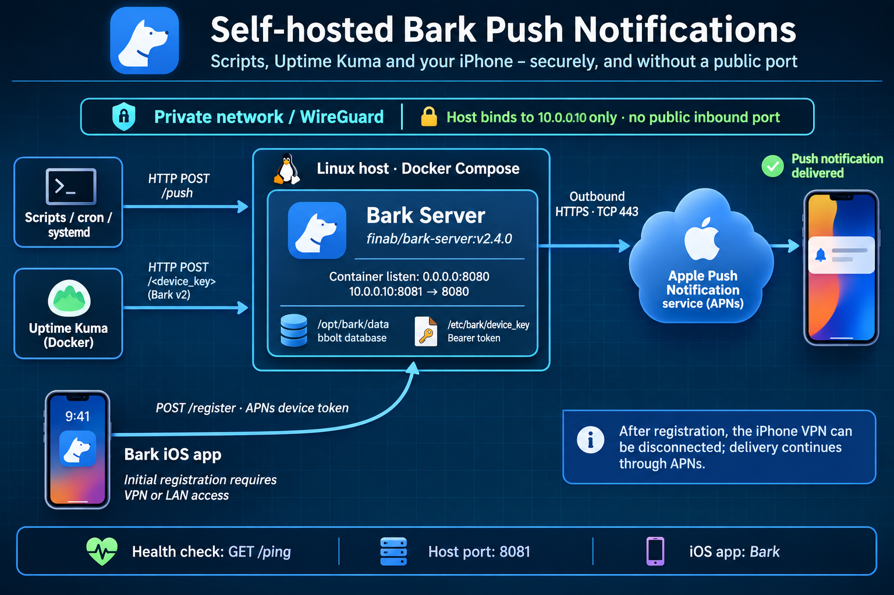

# Self-hosted Bark push notifications to iPhone

A practical guide to running your own [Bark](https://github.com/Finb/Bark) push server in Docker, registering an iPhone, and sending alerts from scripts and Uptime Kuma.

> **Tested with:** Ubuntu 24.04 on arm64 (Oracle Cloud Ampere A1), Docker Compose v2, `finab/bark-server:v2.4.0`, Uptime Kuma 2.x, current iOS.
>
> **Example environment used throughout:** server private IP `10.0.0.10`, host port `8081`, reachable only over a WireGuard tunnel. Replace those with your own values.



---

## Contents

1. [Why Bark](#1-why-bark)
2. [How it works](#2-how-it-works)
3. [Prerequisites](#3-prerequisites)
4. [Pick a host port](#4-pick-a-host-port)
5. [Install the server](#5-install-the-server)
6. [Verify the server](#6-verify-the-server)
7. [Keep it off the internet](#7-keep-it-off-the-internet)
8. [Configure the iPhone app](#8-configure-the-iphone-app)
   - [8.1 Add the server](#81-add-the-server)
   - [8.2 The https prefix trap](#82-the-https-prefix-trap)
   - [8.3 Enable notifications first](#83-enable-notifications-first)
   - [8.4 Find the device key](#84-find-the-device-key)
9. [Send a test push](#9-send-a-test-push)
10. [Store the key and add a helper script](#10-store-the-key-and-add-a-helper-script)
11. [Integrate with Uptime Kuma](#11-integrate-with-uptime-kuma)
    - [11.1 Fill in the form](#111-fill-in-the-form)
    - [11.2 Why the key goes in the endpoint](#112-why-the-key-goes-in-the-endpoint)
    - [11.3 Test and verify](#113-test-and-verify)
    - [11.4 Troubleshooting the Kuma notification](#114-troubleshooting-the-kuma-notification)
12. [Other integrations](#12-other-integrations)
13. [Backups and upgrades](#13-backups-and-upgrades)
14. [Troubleshooting](#14-troubleshooting)
15. [Security model and limits](#15-security-model-and-limits)
16. [Quick reference](#16-quick-reference)

---

## 1. Why Bark

Bark is an iOS app plus a small Go server. You send an HTTP request to your server, it forwards the notification through Apple's APNs, and your iPhone shows it — instantly, without the app running in the background.

Compared with alternatives:

- **No Google/ntfy.sh relay for delivery.** Your server talks to Apple directly.
- **No public domain or TLS required.** Register the phone once over a private network, then push with the tunnel off.
- **Tiny footprint.** ~30–50 MB RAM, one ~15 MB container, arm64 image available.
- **Open source.** App and server are on GitHub under [Finb](https://github.com/Finb).

The trade-off: it is iOS-only, and it is a "fire and forget" push API, not a pub/sub system with topics, history or access control.

---

## 2. How it works

```
 scripts / Uptime Kuma ──POST /push──► bark-server ──HTTPS 443──► Apple APNs ──► iPhone
                                           ▲
              iPhone ──POST /register──────┘
              (once, while it can reach the server)
```

Two separate hops matter:

1. **Registration.** The app hands its APNs device token to your server and receives a **device key** back. This is the only step that needs the phone to reach the server.
2. **Delivery.** Your server sends the push to Apple, and Apple delivers it to the phone. No inbound connection to your server is involved.

That is why a private, VPN-only server works fine: after registration the tunnel can be down and notifications still arrive with full content.

The APNs signing key is embedded in the open-source server (key ID `LH4T9V5U4R`, team `5U8LBRXG3A`), so there is no Apple Developer account or certificate setup. The trade-off is a dependency on the upstream project keeping that key valid.

---

## 3. Prerequisites

- A Linux host with Docker and Compose v2 (`docker compose version`)
- A private IP or LAN address the phone can reach (this guide: `10.0.0.10`)
- Outbound TCP 443 to `api.push.apple.com` (default on most hosts)
- An iPhone with the [Bark app](https://apps.apple.com/app/bark-custom-notifications/id1403753865)
- Optional but recommended: a VPN so the server never needs a public port

Check Docker:

```bash
docker --version
docker compose version
```

---

## 4. Pick a host port

Bark listens on 8080 inside the container, but the **host** port is yours to choose. Check what is already taken:

```bash
docker ps --format 'table {{.Names}}\t{{.Ports}}'
sudo ss -ltnp | grep -E ':808[0-9]'
```

If 8080 is in use (for example by SearXNG), pick 8081. Two containers can both use 8080 *inside* their own namespaces; only the published host port must be unique.

In this guide: **host `8081` → container `8080`**.

---

## 5. Install the server

Create the directory:

```bash
sudo mkdir -p /opt/bark
sudo chown "$USER":"$USER" /opt/bark
cd /opt/bark
```

Create `/opt/bark/docker-compose.yml`:

```yaml
services:
  bark:
    image: finab/bark-server:v2.4.0
    container_name: bark
    restart: unless-stopped
    environment:
      TZ: Europe/Amsterdam                 # change to your timezone
      BARK_SERVER_ADDRESS: "0.0.0.0:8080"
      BARK_SERVER_DATA_DIR: "/data"
    volumes:
      - ./data:/data
    ports:
      # Bind to the PRIVATE address only. Change the IP to your host's.
      - "10.0.0.10:8081:8080"
    healthcheck:
      test: ["CMD-SHELL", "wget -qO- http://10.0.0.10:8080/ping >/dev/null || exit 1"]
      interval: 60s
      timeout: 5s
      retries: 3
      start_period: 10s
    logging:
      driver: json-file
      options:
        max-size: "10m"
        max-file: "3"
```

Notes:

- `0.0.0.0:8080` **inside the container** is correct. Binding the container to your host's private IP fails with `cannot assign requested address`, because that IP does not exist in the container's network namespace.
- The `10.0.0.10:` prefix in `ports` is the access control: it keeps the service off the public interface.
- Pin a version tag instead of `latest` so upgrades are deliberate.

Start it:

```bash
docker compose up -d
docker compose ps
docker compose logs --tail=50 bark
```

Expected lines:

```
Bark Server Listen at: 0.0.0.0:8080 , Database: *database.BboltDB
init apns client success...
```

---

## 6. Verify the server

```bash
curl -s http://10.0.0.10:8081/ping ; echo
curl -s http://10.0.0.10:8081/info ; echo
```

Both return JSON with `"code":200`. Then confirm the bind address:

```bash
sudo ss -ltnp | grep ':8081'
```

You want `10.0.0.10:8081`, **not** `0.0.0.0:8081` or `[::]:8081`.

---

## 7. Keep it off the internet

There is no web UI and there are no accounts: anyone who can reach the port and knows the device key can push to your phone. Two rules:

1. **Bind to a private address** (as above) — never publish `0.0.0.0:8081`.
2. **Do not open the port publicly.** If you use a cloud VCN security list / firewall, do not add an ingress rule for 8081.

A gotcha worth knowing: **Docker-published ports bypass iptables/ufw**, because Docker inserts its own iptables rules. A `iptables/ufw allow`/`iptables/ufw deny` rule is not what protects you here — the specific bind address is.

If the phone reaches the server over a VPN:

```bash
# confirm from the phone's side (after connecting the tunnel)
curl -s http://10.0.0.10:8081/ping
```

No VPN? Bind to a LAN IP (`192.168.x.y`) and only use the app at home, or read the security chapter before exposing anything.

---

## 8. Configure the iPhone app

### 8.1 Add the server

1. Connect the VPN (or be on the same LAN).
2. Open **Bark** → tap **+** (top right).
3. In the address field, enter:

   ```
   http://10.0.0.10:8081
   ```

4. Tap the **✓** button.
5. Enable **Notifications** on Bark's home screen! (crucial step!)

On save, the app calls `GET /ping`. If it succeeds you get "Added successfully" and the new server becomes the current one. Watch the server log while you do it:

```bash
docker compose logs -f bark
```

Expected:

```
10.66.66.2 -> [200] GET /ping
```

(The client IP is your phone's VPN address.)

### 8.2 The https prefix trap

The Add Server field is **pre-filled with `https://`**. If you type the address after it, the app saves `https://10.0.0.10:8081` and tries a TLS handshake against a plain-HTTP port. That fails before any HTTP request exists, so:

- nothing appears in the Bark log,
- you get an "Invalid server" message,
- no server is actually added.

**Select the entire field, delete it, and type the full `http://...` URL.**

### 8.3 Enable notifications first

After a successful add, the app calls `syncAllServers()`, which does nothing if it has no APNs device token:

```swift
guard let token, token.count > 0 else { return }
```

The token only arrives after notification permission is granted. If you tapped "Don't Allow" on first launch, the server is saved but the **key stays empty** and there is no `POST /register` in the log.

Fix:

1. iOS **Settings → Bark → Notifications → Allow Notifications**.
2. Force-quit Bark and reopen it (or tap the "Enable notifications" card on its home screen).
3. On launch it registers with APNs and calls `POST /register` for every configured server.

Expected log after this:

```
10.66.66.2 -> [200] POST /register
```

### 8.4 Find the device key

The key is not shown on the Add Server screen. It appears on Bark's home screen, embedded in the example command:

```
curl -X GET 'http://10.0.0.10:8081/AbCdEf123456/title/body?group=example'
                                  └── device key ──┘
```

While the key is empty, that slot reads `YOUR_KEY` and the copy menu items are greyed out.

There are two reliable ways to copy it:

- **Home screen** → long-press the copy button → **Copy key** (key only) or **Copy address and key** (full URL, which is what Uptime Kuma wants).
- **Server list** (gear → Server) → tap your server row → **Copy address and key**.

Treat this key like a password: it is the only credential needed to push to that phone.

---

## 9. Send a test push

From the server:

```bash
curl -s -X POST http://10.0.0.10:8081/push \
  -H 'Content-Type: application/json; charset=utf-8' \
  -d '{
    "device_key": "YOUR_DEVICE_KEY",
    "title": "Bark test",
    "body": "hello from the server",
    "group": "ops",
    "level": "timeSensitive"
  }'
```

`{"code":200,...}` means Apple accepted the push; the phone should buzz within a second or two.

**Test the tunnel-off case:** disconnect the VPN and send it again. It should still arrive with the full body — delivery goes through Apple, not through your server.

Useful fields:

| Field | Value | Purpose |
|---|---|---|
| `level` | `active`, `timeSensitive`, `critical`, `passive` | `timeSensitive` breaks through Focus |
| `sound` | e.g. `alarm`, `telegraph` | Notification sound |
| `group` | any string | Notification thread grouping |
| `url` | a URL | Opens on tap |
| `badge` | integer | App icon badge |
| `isArchive` | `"1"` | Keep it in the app's history |
| `ttl` | seconds | How long archived messages are kept |

---

## 10. Store the key and add a helper script

Keep the key out of scripts and git. Store it in a root-owned file that your user can read:

```bash
sudo install -d -m 750 /etc/bark
sudo chown root:"$USER" /etc/bark
sudo sh -c 'printf "%s\n" "YOUR_DEVICE_KEY" > /etc/bark/device_key'
sudo chown root:"$USER" /etc/bark/device_key
sudo chmod 640 /etc/bark/device_key
```

> [!NOTE]
> If you run the script as `ubuntu`, a root-only `600` key means you need `sudo` every time. Group-reading it (`640`, directory `750`) avoids that; other users on the box still cannot read it.

Install the helper:

```bash
command -v jq || sudo apt-get update && sudo apt-get install -y jq
```

Create the script:
```bash
sudo nano /usr/local/bin/notify.sh:
```

Paste the script:
```bash
#!/usr/bin/env bash
# usage: notify.sh "Title" "Body" [level] [url]
set -euo pipefail

BASE_URL="${BARK_URL:-http://10.0.0.10:8081}"
KEY_FILE="${BARK_KEY_FILE:-/etc/bark/device_key}"

if [ "$#" -lt 2 ]; then
  echo "usage: $(basename "$0") TITLE BODY [LEVEL] [URL]" >&2
  exit 2
fi
if [ ! -e "$KEY_FILE" ]; then
  echo "error: $KEY_FILE does not exist" >&2; exit 2
fi
if [ ! -r "$KEY_FILE" ]; then
  echo "error: $KEY_FILE is not readable by $(id -un)" >&2; exit 2
fi

KEY="$(<"$KEY_FILE")"
TITLE="$1"; BODY="$2"; LEVEL="${3:-active}"; LINK="${4:-}"

payload=$(jq -nc \
  --arg k "$KEY" --arg t "$TITLE" --arg b "$BODY" \
  --arg l "$LEVEL" --arg u "$LINK" '
  {device_key: $k, title: $t, body: $b, level: $l,
   group: "homelab", isArchive: "1"}
  + (if $u == "" then {} else {url: $u} end)')

curl -fsS -X POST "$BASE_URL/push" \
  -H 'Content-Type: application/json; charset=utf-8' \
  -d "$payload" >/dev/null
echo "sent"
```

Set the correct file permissions:
```bash
sudo chmod 755 /usr/local/bin/notify.sh
```

Check if a test notification works:
```bash
notify.sh "Bark" "script test" timeSensitive
```

Because of `curl -fsS` and `set -e`, a rejected push returns a non-zero exit code — safe for cron and systemd.

**Cron note:** cron's `PATH` is usually `/usr/bin:/bin`, which does not include `/usr/local/bin`. Call the script with its absolute path in crontabs.

---

## 11. Integrate with Uptime Kuma

Uptime Kuma has a built-in **Bark** notification provider; no plugin needed.

> Since Kuma runs in a container, use the **host's private IP** (`10.0.0.10`). Inside the Kuma container, `127.0.0.1` is the container itself, not the host.

### 11.1 Fill in the form

Dashboard → **Settings → Notifications → Setup Notification** → type **Bark**:

| Field | Value |
|---|---|
| Notification Type | Bark |
| Friendly Name | `Bark Kuma Alert` (or whatever you like) |
| Bark API Version | **v2** |
| Bark Endpoint | `http://10.0.0.10:8081/YOUR_DEVICE_KEY` |
| Bark Group | `UptimeKuma` (or whatever you like) |
| Bark Sound | `alarm`, or leave blank for `telegraph` |
| Default enabled | your choice |
| Apply on all existing monitors | your choice |

The endpoint must include the key, for example:

```
http://10.0.0.10:8081/ynJ5Ft4atkMkWeo2PAvFhF
```

No trailing slash needed (Kuma strips one), and **do not use `/push`**.

### 11.2 Why the key goes in the endpoint

In v2 mode Kuma does a `POST` to exactly what you entered, with this body:

```json
{
  "title": "UptimeKuma Monitor Down",
  "body": "...",
  "icon": "https://github.com/.../icon.png",
  "sound": "telegraph",
  "group": "UptimeKuma"
}
```

There is no `device_key` in that body, so the key has to be in the URL path. Bark's `POST /:device_key` route reads it from the path.

If you enter `.../push`, Kuma hits Bark's `/push` route, which expects the key in the body and answers:

```json
{"code":400,"message":"device key is empty"}
```

Using **v1** instead makes Kuma send `GET /<key>/<title>/<body>?...`, which also requires the key in the endpoint. v2 with a JSON body is the better choice.

### 11.3 Test and verify

Click **Test**. You should see "Bark notification succeed", a push on the phone, and this in the Bark log:

```
172.x.x.x -> [200] POST /ynJ5Ft4atkMkWeo2PAvFhF
```

The source is a Docker bridge address because the request comes from the Kuma container, not from the host shell.

Then attach the notification to your monitors (or enable "Apply on all existing monitors" before saving).

### 11.4 Troubleshooting the Kuma notification

| Symptom | Cause | Fix |
|---|---|---|
| `400 device key is empty` | Endpoint ends in `/push` or lacks the key | Append the device key to the endpoint |
| `400` on `POST /<key>` in Bark logs | Wrong or deleted key | Re-copy it in the app; the key is reset per device |
| No request in Bark logs at all | Kuma cannot reach the host IP | `docker exec uptime-kuma wget -qO- http://10.0.0.10:8081/ping` |
| Test passes but no banner | iOS notification permission, Focus, or app reinstalled | Check iOS Settings → Bark → Notifications; re-register |
| Icon missing only | Phone cannot download Kuma's GitHub icon | Cosmetic; ignore or self-host the icon |

---

## 12. Other integrations

**Shell / cron / systemd**

```bash
notify.sh "Backup" "restic failed on db01" critical
```

**n8n** — HTTP Request node: `POST http://10.0.0.10:8081/push`, JSON body:

```json
{
  "device_key": "YOUR_DEVICE_KEY",
  "title": "n8n",
  "body": "Workflow finished",
  "group": "n8n"
}
```

Use `10.0.0.10`, not `127.0.0.1` — the node runs inside a container.

**Apprise** supports Bark, so any service that can call Apprise can fan out to it.

**acme.sh** has a Bark notifier; useful for certificate expiry warnings.

**Multiple devices** — add the server on each iPhone/iPad and each gets its own key. For batch pushes, Bark accepts `device_keys` (an array) instead of `device_key` on `/push`.

---

## 13. Backups and upgrades

The only state is the bbolt database in `/opt/bark/data` (device tokens and keys). Back it up with the container stopped:

```bash
cd /opt/bark
docker compose stop bark
sudo tar czf /root/bark-data-$(date +%F).tgz data
docker compose start bark
```

Losing it is not fatal: the phone simply re-registers and gets a new key, and you update your scripts.

Upgrade deliberately:

```bash
cd /opt/bark
# edit the image tag in docker-compose.yml, then:
docker compose pull
docker compose up -d
docker compose logs --tail=30 bark
```

Rollback is changing the tag back. If **all** devices suddenly stop receiving pushes with a `403`/`BadDeviceToken` from APNs, check for a newer server release: the embedded APNs key may have been rotated upstream.

---

## 14. Troubleshooting

| Symptom | Likely cause | Fix |
|---|---|---|
| `Bind for 10.0.0.10:8081 failed: port is already allocated` | Host port in use | `sudo ss -ltnp \| grep 8081`, choose another port |
| Container restarts in a loop | Bad flag or unwritable `/data` | `docker compose logs bark`; check `ls -ln data` |
| `bind: cannot assign requested address` | `BARK_SERVER_ADDRESS` set to a host IP inside the container | Keep it `0.0.0.0:8080` and publish the host IP in `ports` |
| App says "Invalid server", no `/ping` in logs | `https://` prefix, wrong port, or VPN off | Re-enter as `http://IP:PORT`; check `curl` from the phone |
| Server added, but key is `YOUR_KEY` and no `/register` | Notification permission not granted | Allow notifications, force-quit, reopen |
| `POST /register` returns `device token is empty` | App could not obtain an APNs token | Check Apple connectivity; reinstall/relaunch the app |
| `200` response but no banner | Notifications off, Focus mode, or app reinstalled | iOS Settings → Bark; re-register if reinstalled |
| `400 device token is invalid` | Key belongs to another server or was reset | Re-copy the key |
| Worked for months, then all devices fail | APNs key rotation upstream | Update the server image |
| Notification only appears when opening the app | Bark notifications disabled / "deliver quietly" | Fix iOS notification settings |

---

## 15. Security model and limits

- **The device key is a bearer token.** Anyone who has it can push to that phone. Keep it in `/etc/bark/device_key` (mode `640`), not in git or world-readable files.
- **No ACLs, no topics, no rate limits.** Bark is a single-purpose push API. If you need per-topic access control, ntfy is a better fit.
- **Bind privately.** Published Docker ports bypass ufw; the bind address is the real control. Do not create a public ingress rule for the port.
- **Content transits Apple**, as with every iOS push. Bark also supports encrypted pushes (`ciphertext`) if you want the body hidden even from that hop.
- **Embedded APNs key.** Convenient, but it makes you dependent on the upstream project. If it is ever revoked, upgrading the image is the fix.
- **iOS only.** No Android, no web UI, no message store beyond what the app archives locally.
- **One key per device.** Resetting a key in the app invalidates the old one immediately.

---

## 16. Quick reference

**Files**

| Path | Purpose |
|---|---|
| `/opt/bark/docker-compose.yml` | Container definition |
| `/opt/bark/data/` | Device registrations (back this up) |
| `/etc/bark/device_key` | Device key, readable by your user |
| `/usr/local/bin/notify.sh` | CLI helper |

**Endpoints**

| Method | Path | Purpose |
|---|---|---|
| `GET` | `/ping` | Health check |
| `GET` | `/info` | Server version |
| `POST` | `/register` | App registers its APNs token |
| `POST` | `/push` | Push with `device_key` in the body |
| `POST` | `/<device_key>` | Push with key in the path |
| `GET` | `/<key>/<title>/<body>` | Quick GET push |

**Commands**

```bash
# health
curl -s http://127.0.0.1:8081/ping

# test push
curl -s -X POST http://127.0.0.1:8081/push \
  -H 'Content-Type: application/json' \
  -d '{"device_key":"KEY","title":"Hi","body":"There"}'

# logs
docker compose -f /opt/bark/docker-compose.yml logs -f bark

# restart
docker compose -f /opt/bark/docker-compose.yml restart bark
```

**Kuma in one line:** type `Bark`, version `v2`, endpoint `http://<server-ip>:<port>/<device-key>`.
